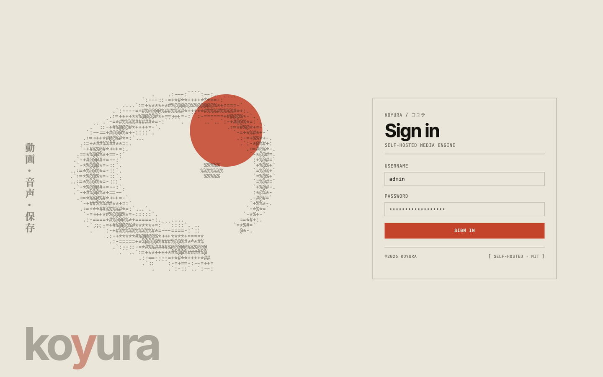

# Koyura

A self-hosted Telegram bot that saves video and audio from YouTube, TikTok,
Instagram and about a thousand other sites, with an admin panel beside it.



Koyura turns a link in a chat into a file: send it, choose a format and a
quality, and the video or the MP3 arrives in the conversation. Next to the bot
there is an admin dashboard with stats, history and errors, and a web
downloader for people who would rather not use Telegram at all.

A dark-theme recording of the same walkthrough lives in
[`images/demo-dark.gif`](images/demo-dark.gif).

## What you get

- MP4 or MP3 with the real formats and file sizes of the link, so the choice is informed.
- MP3 files tagged with title, artist and cover art, ready for any player.
- Uploads up to 2 GB through a self-hosted Bot API server (20 MB without it, Telegram's own limit).
- An admin panel with daily stats, charts, download history, error messages and disk management.
- A web downloader served by the engine, so a browser is enough to fetch a file.
- A real download queue: one job per person, waits estimated from measured timings, and an honest "try again in two minutes" instead of a dead end.
- Automatic cleanup by age and disk usage, concurrency limits and per-download timeouts.

## Quick start

```bash
git clone https://github.com/1-01-dev/koyura-bot.git
cd koyura-bot
cp .env.example .env            # then fill in BOT_TOKEN, TELEGRAM_API_ID,
                               # TELEGRAM_API_HASH and the three secrets
docker compose up -d
```

The dashboard is on <http://127.0.0.1:8080>; the bot answers in Telegram once the
containers are healthy. Without Docker, use the venv and systemd recipe in
[docs/deployment.md](docs/deployment.md).

## Documentation

| Document | Contents |
| --- | --- |
| [configuration.md](docs/configuration.md) | Every variable, its default, generating secrets |
| [deployment.md](docs/deployment.md) | Compose, systemd, Bot API from source, HTTPS |
| [development.md](docs/development.md) | Layout, local run, tests, dev flags |
| [security.md](docs/security.md) | What is hardened, how to report a problem |
| [THIRD-PARTY.md](THIRD-PARTY.md) | Dependencies, links and licences |

## Security

Every engine API call needs the shared internal token, and URLs that resolve to
private or loopback addresses are refused. All secrets live in `.env` and never
in the image or the repository. Read [docs/security.md](docs/security.md) before
you expose the dashboard to anything beyond localhost.

## License

MIT — see [LICENSE](https://github.com/1-01-dev/koyura-bot/blob/main/LICENSE).

Koyura is inspired by the download-bot idea of an earlier MIT-licensed project; third-party components are listed in [THIRD-PARTY.md](https://github.com/1-01-dev/koyura-bot/blob/main/THIRD-PARTY.md) with their licences.
